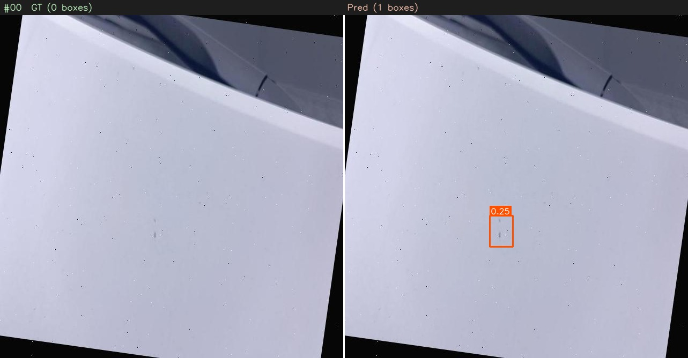
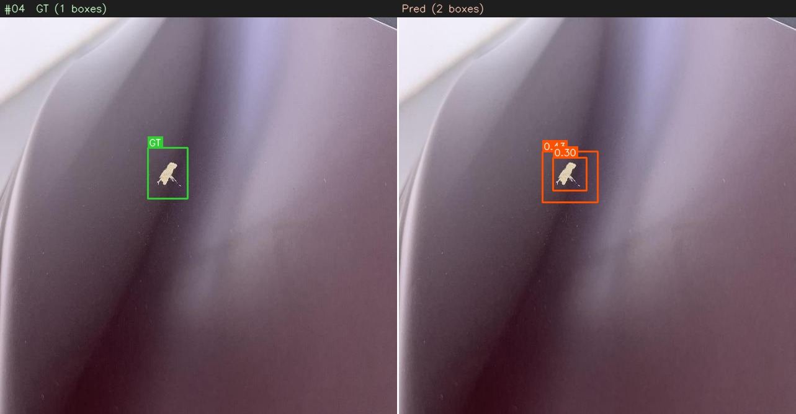
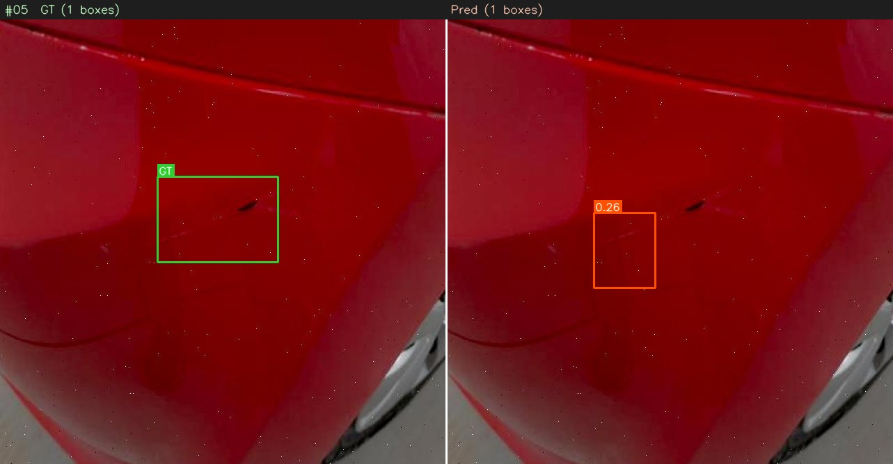

# Small MRF Detection Model

A compact PyTorch object detector for **vehicle damage / defect detection** (scratches and dents on car panels). It is built around a **Multi-Receptive-Field (MRF) backbone**, an FPN-style fusion neck, and decoupled classification / regression heads.

The trained model is also on Hugging Face: [mirzakhojayev/MRF_Defect_Detection](https://huggingface.co/mirzakhojayev/MRF_Defect_Detection)

## Example predictions

Ground truth vs. predicted detections from `eval_images/`:

<p align="center">
  
  
  
</p>

## Model

| | |
|---|---|
| Task | Single-class object detection (`damage`) |
| Input | RGB image, resized to 640×640, scaled to [0, 1] |
| Output | `boxes` (xyxy), `scores`, `labels` |
| Checkpoint | `checkpoint_best.pth` (epoch 150) |
| Best validation mAP@50 | 0.106 |

- **Backbone (`MRFBackbone`)**: stride-2 stem, then 5 stages of `MRFBlock`s (64 → 128 → 256 → 384 → 384 channels). Each block stacks depthwise 3×3 convolutions with increasing dilations (`[1, 2, 4]` / `[1, 2, 6]`), a pointwise projection, a residual connection, and stochastic depth.
- **Neck (`MRFFPNNeck`)**: top-down FPN with 128-channel lateral projections and MRFBlock fusion. It outputs strides 4, 8, 16, and 32.
- **Head (`DecoupledHead`)**: separate classification and box-regression branches per scale. Boxes are regressed as DFL-style distance distributions (`reg_max = 32`).
- **Post-processing**: confidence filtering and hard NMS (IoU 0.4, default confidence 0.15).

## Project structure

```
├── config.yaml           # model / training / augmentation / eval settings
├── model.py              # MRFDet model definition (build_model)
├── data.py               # dataset and augmentation pipeline
├── train.py              # training loop
├── eval.py               # evaluation (mAP@50, mAP@50:95, recall@50)
├── app.py                # Gradio demo
├── checkpoint_best.pth   # trained weights
├── eval_images/          # GT vs. prediction visualizations
└── requirements.txt
```

## Installation

```bash
git clone https://github.com/Mirzakhojayev/Small_MRF_Detection_Model.git
cd Small_MRF_Detection_Model
pip install -r requirements.txt
```

## Training

The scripts expect the dataset at `../coco_dataset` by default. That folder holds the `train.txt` / `val.txt` / `test.txt` split files and is not included in this repo.

```bash
python train.py
```

Optional flags:

- `--epochs`
- `--batch_size`
- `--checkpoint_dir` (default: `checkpoints/`)
- `--log_dir`
- `--resume`

Training settings from `config.yaml`:

- 150 epochs, batch size 32, image size 640
- AdamW optimizer, 5 warmup epochs, cosine decay (1e-3 → 1e-6), low-LR fine-tuning from epoch 131
- EMA (decay 0.9995), weight decay 5e-4, stochastic depth 0.15, dropout 0.1
- Focal classification loss + box loss + DFL, with an FCOS-style center-sampling assigner
- Augmentation: mosaic, HSV jitter, horizontal flip, scale, cutout, mixup, rotation
- 70 / 15 / 15 split **by car ID**, so no car appears in more than one split

## Evaluation

```bash
python eval.py --checkpoint checkpoint_best.pth
```

Optional flags:

- `--config` (default: `config.yaml`)
- `--dataset_root` (default: `../coco_dataset`)
- `--split` (`val` or `test`, default: `val`)
- `--conf`: overrides the confidence threshold from `config.yaml`

## Demo

```bash
python app.py
```

This opens a Gradio app at http://127.0.0.1:7860. Upload a photo of a car panel and adjust the confidence threshold.

## Loading from Hugging Face

```python
import sys, torch, yaml
from huggingface_hub import snapshot_download

repo_dir = snapshot_download("mirzakhojayev/MRF_Defect_Detection")
sys.path.insert(0, repo_dir)
from model import build_model

cfg = yaml.safe_load(open(f"{repo_dir}/config.yaml"))
model = build_model(cfg)
ckpt = torch.load(f"{repo_dir}/checkpoint_best.pth", map_location="cpu", weights_only=False)
model.load_state_dict(ckpt.get("ema_state_dict", ckpt["model_state_dict"]), strict=False)
model.eval()
```

## Limitations

- The model detects a single generic `damage` class. It does not separate scratches from dents or estimate severity.
- Validation mAP@50 is modest (0.106). Treat this as an experimental / research model.

## License

MIT
